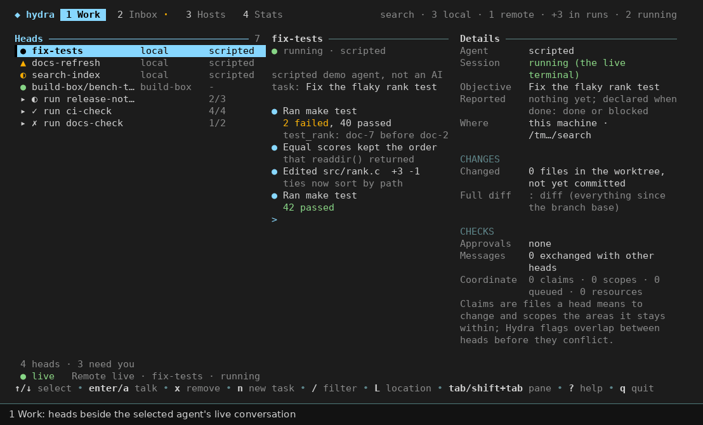

<p align="center">
  <a href="https://github.com/Someblueman/hydra">
    
  </a>
</p>

# Hydra

**Native mission control for coding agents, worktrees, and remote fleets.**

Hydra coordinates coding agents across local projects and remote SSH hosts. Give
each task its own branch, working directory, and terminal session, monitor work
from the native TUI, and bring changes together through review and verification.

It runs on macOS and Linux without a daemon, database, or cloud account. Git holds
your code, tmux keeps sessions running, and SSH connects your hosts. You can also
use ordinary shell sessions alongside agents.

[](https://github.com/Someblueman/hydra/actions)
[](https://github.com/Someblueman/hydra/releases)
[](LICENSE)



A tour of the four screens of `hydra tui`, recorded from this checkout against a
throwaway repository: real heads, plan and workflow runs, a scripted stand-in for
the agent and a recorded remote-host observation.
[What it shows and how to re-record it](assets/demos/README.md)

**v3.0.0** makes the control centre one workspace for local and remote work:
`hydra tui` shows the heads and tasks of your registered hosts beside local work,
with their host and how fresh each observation is, and attaches, interrupts and
answers remote work with the same keys. Remote tasks can be placed automatically
on an eligible host, task pools and host-timer schedules run work through the
same commands, and onboarding many hosts gains live inventory sources, revocation
and an operator view. This is a major release: see the changelog's compatibility
notes before upgrading scripts or fleet hosts.
Install the
[latest release](https://github.com/Someblueman/hydra/releases/latest) and see the
[changelog](CHANGELOG.md) for features and upgrade notes. Next work is tracked in
[the roadmap](docs/ROADMAP.md#next-target-live-and-human-acceptance)
and [usability testing](docs/USABILITY-TESTING.md).

## What you can do

- **Lead from native mission control.** Four screens in the native C TUI: Work
  (your heads beside each agent's conversation and its details, plan and run),
  Inbox (everything waiting for you, acted on in place), Hosts and Stats.
- **Run coding agents across your fleet.** Select agent profiles and task prompts,
  bootstrap trusted SSH hosts, launch remote heads and workflows, and attach to
  their sessions. Inspect host-qualified heads in the native fleet view.
- **Work in parallel.** Create isolated heads with named agent profiles, task
  prompts, and terminal layouts. Switch between them without changing directories
  or disturbing another task's working tree.
- **See what is happening.** Inspect sessions from native mission control, a tmux
  dashboard, or the CLI. Query structured state and retain lifecycle history.
- **Coordinate work.** Run finite workflows with named inputs, sealed outputs,
  durable approval waits and bounded retries. Exchange messages, declare file
  scopes, and detect collisions between heads.
- **Deliver an objective.** Let an agent propose a short plan, read and approve it
  in one step, and land the commit its checks verified.
- **Review and integrate.** Inspect diffs and provenance, run verification gates,
  and use guarded integration commands to assemble changes.

Hydra coordinates processes and records evidence. Agent activity does not imply
that a task is complete or that its changes are correct.

## Installation

You need Git, Make, and a C99 compiler. Interactive heads need tmux 3.0 or newer;
headless execution and installation work without it. Fleet additionally needs
`pkg-config` and JSON-C development files (`brew install json-c pkg-config` on
macOS, or `apt install libjson-c-dev pkg-config` on Ubuntu). The installer builds
the native TUI; build the fleet coordinator before installing.

```sh
git clone https://github.com/Someblueman/hydra.git
cd hydra
make build-fleet
PREFIX="$HOME/.local" ./install.sh
export PATH="$HOME/.local/bin:$PATH"
hydra version
hydra doctor
```

Add `$HOME/.local/bin` to your shell's `PATH` to keep the command available in new
terminals. You can also run `bin/hydra` directly from a checkout without installing.
Headless agents: **Antigravity (`agy`), Cursor Agent, OpenCode, Claude Code,
Codex, and Pi**. See [agent profiles and inputs](docs/USAGE.md#agent-profiles-and-inputs) for interactive
launch support, executable names, capabilities, and live qualification limits.
Cursor requires `cursor-agent`. Cursor local/remote and Antigravity remote live
qualification await sign-in; Claude remote qualification remains deferred.

GitHub CLI, `fzf`, and coding agents are optional integrations. For a compiler-free
local installation, skip `make build-fleet` and set `HYDRA_INSTALL_TUI=never` when
running the installer. `hydra tui` is then unavailable; `hydra list` and
`hydra switch` work without the native helper.

Upgrading from 1.9? Review the compatibility and backup notes in
[Contracts](docs/CONTRACTS.md) before upgrading.

## Start a task

From a Git repository with an initial commit:

```sh
hydra init --no-agent --trust
HYDRA_NO_SWITCH=1 hydra spawn feature/search --no-agent
hydra list
hydra switch feature/search
```

A *head* is a branch with its own worktree and tmux session. `spawn` normally
prints where the head lives and stays in your terminal; `hydra spawn <branch> --attach`
attaches immediately and `HYDRA_NO_SWITCH=1` always keeps you where you are.
`switch` attaches to the named session. Detach with `Ctrl-b`, then `d`, to return to your original terminal.
`init --trust` accepts the current repository-controlled Hydra configuration;
review existing configuration before accepting it.

To use a coding agent, select an installed profile explicitly:

```sh
hydra agent list
hydra spawn feature/tests --profile codex --prompt "Add tests for search"
```

Agents run in the head's worktree. Choose `--no-agent` whenever you want a regular
shell. [Agent profiles and inputs](docs/USAGE.md#agent-profiles-and-inputs) describes selection and setup.

## Inspect and finish

```sh
hydra tui                         # native mission control
hydra diff feature/search --stat
hydra exec --branch feature/search -- make test # use your project's test command
hydra review feature/search --json
```

To steer an agent, queue an inbox message with `hydra send feature/search "Review
the failing test"`; read it with `hydra recv --peek` inside that head. A queued
message is not evidence of consumption or completion.

In the native control centre `1`-`4` switch between Work, Inbox, Hosts and
Stats, `Tab` moves between a screen's panes, `[` / `]` between a pane's pages,
arrows select, `Enter` opens and `Esc` steps back. In Work `n` starts a task,
Enter (or `a`) talks to the selected agent, `x` removes heads after an in-app
confirmation; Inbox is where approvals, failed checks and results to review wait.
`:` searches every action, `?` shows the keys for where you are and `q` exits.
See [TUI](docs/USAGE.md#tui) for each screen.

After reviewing and preserving the work you need, stop the head from your original
terminal:

```sh
hydra kill feature/search
```

Stopping a head removes its session and worktree and retains lifecycle history.
Its Git branch remains available. See [workflows](docs/workflows.md) for review,
recovery, and landing changes.

## Manage a fleet

Register trusted SSH hosts, bootstrap a pinned Hydra package, and coordinate work
across their existing repositories. Fleet supports remote agent-backed heads,
workflow execution and cancellation, interactive attach, and explicit transfers of
configuration and workflow history.

```sh
hydra remote add build ubuntu@build-host
# Bootstrap a matching package as described in the fleet setup guide.
hydra fleet list --json
hydra fleet spawn build --project /srv/project -- feature/search --profile codex \
  --prompt "Implement search and run the project tests"
hydra fleet tui
```

Remote heads and tasks then appear in `hydra tui` beside local work, with their
host and observation age; `L` filters by location, `a` attaches and `x`
interrupts through the fleet commands, and `hydra fleet tui` opens the same
four screens with the location filter set to remote work. Agent executables and repositories live
on the host that runs the work. See [fleet setup](docs/FLEET.md) for pinned
bootstrap, host requirements, remote workflows, and recovery behavior.
`hydra fleet discover --source ssh-config|
ansible-inventory:FILE|dns-sd` lists candidates from your own inventories with a
diff against the previous snapshot, and `hydra fleet revoke` records a final,
local revocation of a candidate, source, alias, package or project decision.
`O` on the control centre's Hosts tab reviews those candidates, their
qualification and per-host enrollment progress, and runs `hydra fleet enroll
apply` only after you type the reviewed intent's digest.
New remote tasks can be placed automatically across eligible hosts
(`hydra fleet task submit --placement auto`), with every decision recorded and
replayable (`hydra fleet placement explain|replay`); explicit host pinning is the
default. 
## Plan an objective

Ask an agent in a head to plan the work with you. It writes a short plan
(`hydra plan schema` prints the format on one screen): the objective, the
steps, the command that checks the work and what counts as done, and publishes
it with `hydra plan propose plan.json`. Hydra checks it against the project's
plan policy at once and tells the agent what to fix. Then, from your own
terminal:

```sh
hydra plan show       # the plan in words: steps, instructions, commands, limits
hydra plan approve    # shows it again and asks once; runs exactly that revision
hydra plan status     # follow the run
hydra plan review     # the result: verdict, the worker's commit and diff, checks
hydra land <worker>   # merge the verified commit into your current branch
```

Every step runs on one new worker branch; Hydra commits the agent's changes
there and a check passes when its command exits 0 on that commit. Nothing runs
without your approval of the exact revision shown, a republished plan needs
approving again, and landing is a local merge you confirm, never a push.
Approving from inside an agent's head is refused. See
[workflows](docs/workflows.md#objective-planning) for the flow and its advanced
plans (`hydra workflow plan`: the full schema, custom checks, schema 2,
obligations, repair and reuse) and the [planning examples](examples/planning/README.md).

For comparing and growing plans, `hydra workflow plan evaluate` compares two
compiled alternatives by decomposition, fixed-graph scheduling and placement with
ranges and explicit unknowns, `plan decision` records why one was selected and
replays that comparison from its recorded inputs, and `make test-plan-eval`
measures held-out planning quality. `hydra workflow plan expand` admits a bounded
expansion of a finished run as a new version compiled under the same policy, with
retries kept apart from new claims; each round runs with its own exact digest and
its steps pass the same per-step guard as any approved plan. Use `hydra workflow
replay <run-id>` to check recorded scheduling choices. Planning does not call a
model itself; an ordinary agent authors the proposal through the CLI.

## Documentation

| Topic | Guide |
| --- | --- |
| Commands, layouts, hooks, configuration, and TUI keys | [Usage](docs/USAGE.md) |
| Remote hosts, bootstrap, and fleet operations | [Fleet](docs/FLEET.md) |
| Agent profiles and prompts | [Usage: agent profiles and inputs](docs/USAGE.md#agent-profiles-and-inputs) |
| Workflows and guarded integration | [Workflows](docs/workflows.md) |
| Agent-authored objectives and staged plans | [Workflows](docs/workflows.md) |
| Task pools and host-timer schedules | [Workflows: pools and schedules](docs/workflows.md#pools-and-schedules) |
| State, trust, and public interfaces | [Contracts](docs/CONTRACTS.md) |
| Releases and upcoming work | [Changelog](CHANGELOG.md) · [Roadmap](docs/ROADMAP.md) |

## Development

The CLI and lifecycle orchestration use POSIX shell; optional native helpers use C.
Source qualification needs GNU Make, ShellCheck, dash, Git, tmux, and a C compiler.
The fleet build additionally needs pkg-config and JSON-C development files.

Fleet C code is grouped under `src/fleet/{agent,auth,plan,task,workflow,transport,support}`.
Domain headers expose their own contracts; support headers cover bounded files,
JSON and subprocess capture. The native TUI lives in `src/tui/`, with independently
compiled model, adapter, selection, rendering, input and terminal modules, one
binding table for every key (`keys.c`, `bindings.c`) and a module per screen
(`work*.c`, `inbox*.c`, `hosts*.c`, `statistics*.c`). Work's panes hold attached
tmux clients, the plan with its approval, and the selected run's graph and
evidence. Dialogs, help, the palette, toasts, statistics and graph rendering use
the reusable `src/kettle/` components; see its [standalone library guide](src/kettle/STANDALONE.md).

Testing requires a C99 compiler, JSON-C development files and pkg-config in
addition to Git, tmux, dash and ShellCheck. Python is not required; Make builds
the native test fixtures and example programs.

```sh
make lint       # ShellCheck and shell syntax
make test-all   # Complete acceptance suite, including native and PTY checks
make sanitize   # All native sanitizer checks
make sanitize-fleet # Focused fleet, agent and planning sanitizer checks
make help       # Build, package, and focused test targets
```

Fleet acceptance runs four independent cases at a time after building shared
fixtures. Use `make test-fleet TEST_JOBS=1` for a serial run or set `TEST_JOBS`
to another worker count. Case timings appear in the console; complete output
is retained in `build/test-logs/` (under the selected `BUILD_DIR` for sanitizer
builds). Failed cases print their output and fail the target.
CI splits the same case list between `FLEET_SHARD=odd` and `FLEET_SHARD=even`,
with two workers per runner to limit process contention;
the default `FLEET_SHARD=all` retains the complete local suite.

Contributions should include checks appropriate to their scope. Versions are
chosen at release time from compatibility impact and documented in the changelog.

## Uninstall

Use the same prefix as installation:

```sh
PREFIX="$HOME/.local" ./uninstall.sh
```

The uninstaller prompts about removing user data. See `./uninstall.sh --help` for
options before choosing a non-interactive purge.

## License

[MIT](LICENSE)
